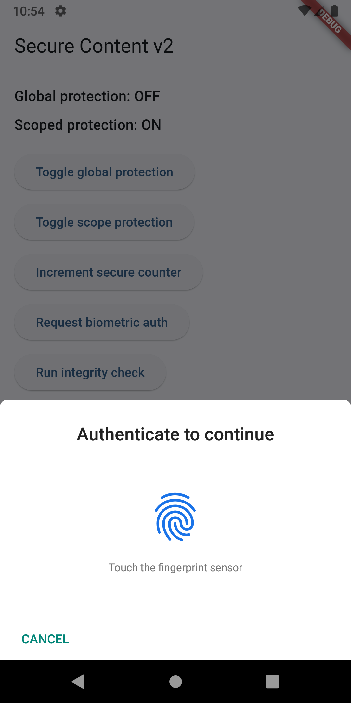
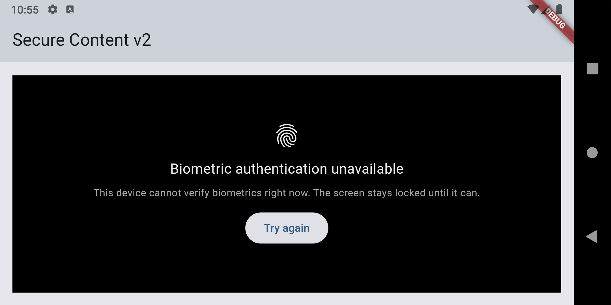
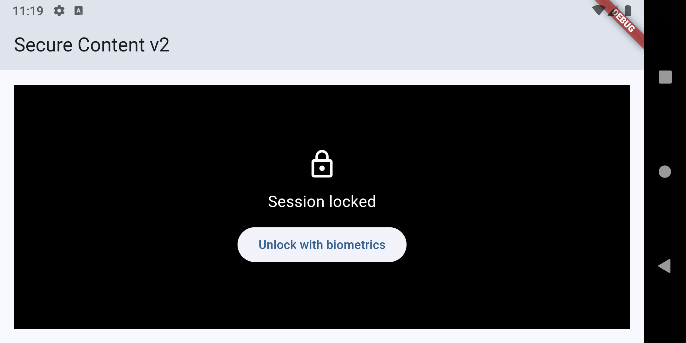

# Idle-lock events and activity recreation: device evidence

Device: AVD `sc_api28` (Android 9, API 28, arm64), fingerprint enrolled.
Build: example app in debug mode with temporary changes that are not committed:

- `android:configChanges` without `orientation|screenSize|smallestScreenSize|screenLayout`, so a rotation recreates the activity.
- `debugPrint('SC_EVENT ${event.type.name}')` in the example `onEvent`.
- `SC_NATIVE` log lines in `BiometricAuthentication.request`, `cancel`, and `finish`, and in `SecureContentPlugin.onAttachedToEngine`.

Screenshots come from the emulator host framebuffer (`adb emu screenrecord screenshot`), because `FLAG_SECURE` blanks device-side screenshots. The landscape images are rotated to read upright.

## Activity recreation during a biometric prompt

| Before (`main`) | After (this branch) |
| --- | --- |
|  | |
|  |  |

The rotation destroys the engine. A new engine and plugin attach to the recreated activity, and the old `BiometricAuthentication` still holds the lease on the retained `ViewModelStore`:

- Before: [`recreation_before.log`](android-api28/recreation_before.log) shows `acquire failed … holder=<old instance>` followed by `SC_EVENT biometricUnavailable`. The old prompt's cancellation drains about 390 ms later.
- After: [`recreation_after.log`](android-api28/recreation_after.log) shows the same race, followed by `SC_EVENT biometricAuthFailed`. The scope stays locked with "Unlock with biometrics". A tap opens a new prompt, and the fingerprint unlocks the scope (`biometricAuthSucceeded`, `idleLockReleased`). This run used the final branch, including the Codex review fixes.

## Idle lock after resuming past the deadline

The example uses `inactivityTimeout: 20 s` and `requireBiometricOnResume: true`. Steps: unlock, press HOME, wait 30 s, resume, unlock ([`idle_resume_steps.txt`](android-api28/idle_resume_steps.txt)).

- Before: [`idle_resume_before.log`](android-api28/idle_resume_before.log) shows two `idleLockActivated` events 5 ms apart after the resume. The first `idleLockReleased` has no matching `idleLockActivated`.
- After (branch before the Codex review fixes, which only change disposed or disabled scopes): [`idle_resume_after.log`](android-api28/idle_resume_after.log) shows `idleLockActivated` and `idleLockReleased` alternating: one pair for the initial lock, and one pair for the resume.
